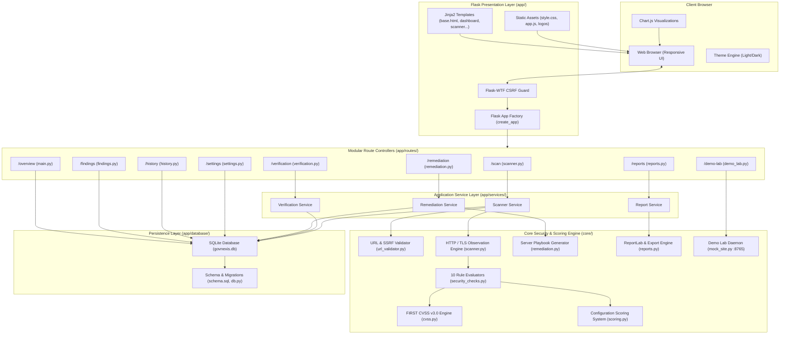

# GOVNEXIS 3.0 — Government Website Security Configuration Auditing Platform

> **"See the Risk. Fix the Gap. Build Trust."**  
> *Platform Version:* **3.0.0** | *Created by:* **Team NEXION**  
> *Core Focus:* **Defensive Security Configuration Auditing & FIRST CVSS v3.0 Posture Analysis**

---

## Table of Contents

- [1. Executive Summary](#1-executive-summary)
- [2. Problem Statement and Objectives](#2-problem-statement-and-objectives)
- [3. Principal Technologies](#3-principal-technologies)
- [4. System Architecture](#4-system-architecture)
- [5. Repository Structure](#5-repository-structure)
- [6. Platform Features & Navigation Modules](#6-platform-features--navigation-modules)
- [7. Security Controls and Standards Cross-Reference](#7-security-controls-and-standards-cross-reference)
- [8. CVSS v3.0 Scoring Methodology & Configuration Metrics](#8-cvss-v30-scoring-methodology--configuration-metrics)
- [9. Defensive Safeguards & SSRF Mitigations](#9-defensive-safeguards--ssrf-mitigations)
- [10. Technology Stack](#10-technology-stack)
- [11. Installation and Setup Guide](#11-installation-and-setup-guide)
- [12. Comprehensive Usage Guide](#12-comprehensive-usage-guide)
- [13. Local Demo Lab Simulation Harness](#13-local-demo-lab-simulation-harness)
- [14. Reports and Data Storage](#14-reports-and-data-storage)
- [15. Automated Testing and Verification](#15-automated-testing-and-verification)
- [16. Limitations and Operational Boundaries](#16-limitations-and-operational-boundaries)
- [17. Planned Roadmap](#17-planned-roadmap)
- [18. Team and Acknowledgements](#18-team-and-acknowledgements)
- [19. License and Ethical Use Disclaimer](#19-license-and-ethical-use-disclaimer)
- [20. References and Standards](#20-references-and-standards)

---

## 1. Executive Summary

Public-facing government portals, municipal websites, and civic digital infrastructure serve as the primary interface between citizens and critical state services. While perimeter network firewalls and web application firewalls (WAFs) receive significant operational attention, fundamental HTTP response headers, session cookie security flags, and Transport Layer Security (TLS) configuration hygiene are frequently neglected or misconfigured. These oversights leave public services vulnerable to clickjacking, cross-site scripting (XSS) amplification, credential theft over insecure channels, and protocol downgrade attacks.

**GOVNEXIS 3.0** is an independently runnable, defensive web security configuration auditing platform developed by **Team NEXION**. Built specifically for authorized system administrators, security officers, and public sector web operations teams, GOVNEXIS 3.0 executes non-destructive, passive evaluations of web server configurations. 

Rather than executing invasive penetration tests or fuzzing endpoints, the platform inspects public HTTP/TLS handshakes and response headers against federal security mandates, including **CISA Binding Operational Directive (BOD) 18-01**, **NIST SP 800-52 Revision 2**, and **OWASP Secure Headers Project** guidelines.

### Core Distinctions
- **Technical Vulnerability vs. Configuration Hygiene:** Findings representing confirmed technical attack vectors (e.g., missing HSTS permitting SSL stripping, absent CSP facilitating script injection) are formally evaluated using the **official FIRST Common Vulnerability Scoring System (CVSS) v3.0** specification. Conversely, defense-in-depth configuration hygiene items lacking verified direct exploit chains (e.g., absent `Permissions-Policy` or `Referrer-Policy`) are transparently classified as **Not Scored** to avoid speculative risk inflation.
- **Empirical Before-and-After Verification:** Rather than relying on static checklists, GOVNEXIS 3.0 provides differential delta analysis that compares baseline misconfigured audits against post-hardening scans, scientifically demonstrating CVSS risk reduction and resolved findings.
- **Defensive Engineering Playbooks:** Automatically generates copy-pasteable server configuration directives tailored to Nginx, Apache HTTP Server, Caddy, Microsoft IIS, and Cloudflare.

---

## 2. Problem Statement and Objectives

### The Problem
Public web properties frequently suffer from subtle configuration drift:
1. **Unenforced HTTPS & Absent HSTS:** Visitors connecting via unencrypted HTTP or without long-duration `Strict-Transport-Security` headers remain vulnerable to man-in-the-middle (MitM) eavesdropping and certificate downgrade attacks.
2. **Missing Frame and Content Boundaries:** The absence of `X-Frame-Options` and `Content-Security-Policy` leaves portal forms vulnerable to clickjacking overlays and unconstrained third-party script execution.
3. **Insecure Cookie Transmission:** Session and authentication cookies omitted from `Secure`, `HttpOnly`, or `SameSite` flags are susceptible to interception over plaintext channels and cross-site scripting exfiltration.
4. **Information Leakage:** Verbose server software banners (`Server`, `X-Powered-By`) expose exact operating system and software versions, simplifying targeted reconnaissance for threat actors.

### Project Objectives
- **Automate Audit Consistency:** Deliver repeatable, non-destructive evaluations of web servers in seconds without external commercial dependencies.
- **Enforce Official CVSS v3.0 Fidelity:** Implement the exact mathematical equations, Scope adjustment rules, and rounding logic defined by FIRST.org, eliminating arbitrary scoring matrices.
- **Provide Actionable Remediation:** Supply platform-specific hardening snippets directly alongside findings so system administrators can immediately apply fixes.
- **Support Lifecycle Task Tracking:** Allow security teams to track finding remediation status (`Open`, `In Progress`, `Fixed`, `Verified`) directly in local storage.
- **Demonstrate Measurable Risk Reduction:** Empower operators to perform side-by-side verification rescans to prove security improvements to compliance auditors.

### Auditing Workflow
```
[Authorized Target Input]
           │
           ▼
[Safety & SSRF Validation] ──(Fails: Private IP / Unresolved DNS)──► [Block & Abort]
           │
           ▼ (Passes: Valid FQDN, Public IP, Scheme Validated)
[HTTP / TLS Observation Engine]
           │
           ▼
[Security Rule Evaluators (10 Checks)]
           │
           ▼
[FIRST CVSS v3.0 Assessment & Vector Generation]
           │
           ▼
[Remediation Playbook Generation] ──► [Local SQLite Persistence]
           │
           ▼
[Follow-Up Audit & Verification Delta] ──► [Multi-Format Exports (PDF/HTML/JSON/CSV)]
```

---

## 3. Principal Technologies

| Technology | Role in GOVNEXIS 3.0 | Module Location |
|:---|:---|:---|
| **Python 3.10+ / 3.13** | Core runtime environment | Entire codebase |
| **Flask 3.0+** | Web application framework and Blueprint routing | `app/`, `run.py` |
| **Flask-WTF / CSRF** | Cross-Site Request Forgery token protection | `app/extensions.py` |
| **Jinja2** | Server-side HTML template rendering | `app/templates/` |
| **SQLite 3** | Parameterized relational audit storage and history | `app/database/db.py` |
| **Requests 2.31+** | Non-destructive HTTP observation client | `core/scanner.py` |
| **Python `ssl` / `socket`** | TLS handshake and X.509 certificate inspection | `core/security_checks.py` |
| **ReportLab 4.0+** | Vector PDF executive report generation | `core/reports.py` |
| **Chart.js 4.4+** | In-browser CVSS distribution and trend charts | `app/static/js/app.js` |
| **Vanilla CSS & JS** | Custom dark/light responsive interface | `app/static/css/style.css` |
| **pytest 8.0+ / 9.0+** | Comprehensive unit, e2e, and integration tests | `tests/` |

---

## 4. System Architecture

GOVNEXIS 3.0 is built on a modular, decoupled architecture consisting of a presentation layer, route blueprint controllers, an orchestration service layer, a domain-driven core engine, and a persistence layer.



### Architectural Layer Responsibilities
1. **Presentation Layer (`app/templates/`, `app/static/`)**: Implements standard-compliant HTML5 and responsive CSS with a dedicated purple, black, and dark-grey theme system. Enforces strict zero-emoji iconography using inline SVGs.
2. **Route Controller Layer (`app/routes/`)**: Registers nine distinct Blueprints corresponding to the core navigation hierarchy. Validates incoming requests and enforces CSRF tokens.
3. **Service Layer (`app/services/`)**: Orchestrates workflow logic, including background scans, comparative verification, task status updates, and report generation.
4. **Core Security Engine (`core/`)**: Standalone, framework-agnostic cybersecurity evaluation library containing SSRF validation, raw HTTP/socket observation routines, official FIRST CVSS v3.0 calculation, and ReportLab PDF document compilation.
5. **Persistence Layer (`app/database/`)**: Manages SQLite connections, database migrations, foreign-key constraints, parameterized query execution, and audit trail indexing.

---

## 5. Repository Structure

```
govnexis-3.0/
├── app.py                      # Alternate application runner
├── config.py                   # Centralized configuration (Dev, Prod, Test environments)
├── govnexis.db                 # Parameterized SQLite production database
├── LICENSE                     # MIT open-source license
├── README.md                   # Comprehensive platform documentation
├── requirements.txt            # Locked Python package dependencies
├── run.py                      # Primary production application entry point
├── .env.example                # Deployment environment variable template
├── .gitignore                  # Git tracking exclusion filters
│
├── app/                        # Main Flask Application Package
│   ├── __init__.py             # Flask application factory (create_app) & security headers
│   ├── extensions.py           # Extension instances (Flask-WTF CSRF)
│   ├── database/               # Database persistence module
│   │   ├── __init__.py         # Package exports
│   │   ├── db.py               # SQLite queries, connection pooling, and migrations
│   │   └── schema.sql          # Relational tables and index definitions
│   ├── routes/                 # Blueprint controllers (9 navigation modules)
│   │   ├── __init__.py         # Route package initialization
│   │   ├── demo_lab.py         # 8. Local Demo Lab controller (/demo-lab)
│   │   ├── findings.py         # 3. Findings Explorer controller (/findings)
│   │   ├── history.py          # 6. Historical audit management (/history)
│   │   ├── main.py             # 2. Executive Overview and metrics (/overview)
│   │   ├── remediation.py      # 4. Remediation checklist & task tracking (/remediation)
│   │   ├── reports.py          # 7. Multi-format report export controller (/reports)
│   │   ├── scanner.py          # 1. New Scan launcher & execution handler (/scan)
│   │   ├── settings.py         # 9. Standards mappings, diagnostics, and About Us (/settings)
│   │   └── verification.py     # 5. Differential audit verification controller (/verification)
│   ├── services/               # Application service layer
│   │   ├── __init__.py         # Package exports
│   │   ├── cvss.py             # Service wrapper for CVSS calculations
│   │   ├── remediation_service.py # Remediation lifecycle and task management
│   │   ├── report_service.py   # Multi-format report generation service
│   │   ├── scanner_service.py  # Orchestrates network auditing and check dispatch
│   │   ├── scoring.py          # Configuration compliance score aggregation
│   │   ├── security_checks.py  # Security check rule adapters
│   │   └── verification_service.py # Differential audit delta calculations
│   ├── static/                 # Static frontend assets
│   │   ├── css/
│   │   │   └── style.css       # Unified design system & responsive layout styling
│   │   ├── images/
│   │   │   ├── govnexis_logo.png # Official GOVNEXIS platform logo
│   │   │   └── nexion_logo.png   # Official Team NEXION metallic emblem
│   │   └── js/
│   │       └── app.js          # Client-side tabs, copy buttons, CSRF headers, and charts
│   └── templates/              # Responsive Jinja2 HTML templates
│       ├── 404.html            # Resource not found error template
│       ├── 500.html            # Internal server error fallback template
│       ├── base.html           # Master layout with sidebar navigation and brand headers
│       ├── dashboard.html      # 2. Executive Overview dashboard template
│       ├── demo_lab.html       # 8. Interactive Demo Lab sandbox template
│       ├── findings.html       # 3. Filterable Findings Explorer template
│       ├── history.html        # 6. Audit history archive template
│       ├── remediation.html    # 4. Remediation playbooks and checklist template
│       ├── reports.html        # 7. Document preview and download center template
│       ├── scanner.html        # 1. New Scan audit execution template
│       ├── settings.html       # 9. Settings, standards matrix, and Team NEXION template
│       └── verification.html   # 5. Before-and-after audit comparison template
│
├── core/                       # Framework-Agnostic Core Security Engine
│   ├── __init__.py             # Core package initialization
│   ├── config.py               # Core constants, version, and default thresholds
│   ├── cvss.py                 # Official FIRST CVSS v3.0 mathematical specification
│   ├── database.py             # Core database interface
│   ├── mock_site.py            # Local sandbox daemon server (port 8765)
│   ├── remediation.py          # Server configuration hardening snippets
│   ├── reports.py              # ReportLab vector PDF, HTML, JSON, and CSV engines
│   ├── scanner.py              # HTTP/TLS raw network observation engine
│   ├── scoring.py              # Configuration compliance scoring equations
│   ├── security_checks.py      # 10 security check rule implementations
│   └── url_validator.py        # SSRF defense, IP parsing, and DNS validation
│
├── data/                       # Local runtime data directory
├── docs/                       # Project documentation artifacts
│   └── PROJECT_WALKTHROUGH.md  # Detailed migration and design walkthrough
├── exports/                    # Report export staging cache
├── scripts/                    # Maintenance and build utility scripts
│   └── build_hackathon_pdf.py  # Documentation export utility
└── tests/                      # Automated Verification & Test Suite
    ├── __init__.py             # Test package initialization
    ├── conftest.py             # Shared pytest fixtures and test clients
    ├── test_cvss.py            # CVSS v3.0 equations, vectors, and reference tests
    ├── test_database.py        # SQLite persistence and migration tests
    ├── test_e2e_workflow.py    # Complete end-to-end lifecycle integration tests
    ├── test_flask_app.py       # Route rendering, headers, and CSRF tests
    ├── test_mock_site.py       # Sandbox server baseline vs hardened tests
    ├── test_reports.py         # Multi-format report export validation tests
    ├── test_scanner.py         # Scanner timeout and error handling tests
    ├── test_scoring.py         # Configuration scoring boundary tests
    ├── test_security_checks.py # 10 security check evaluation unit tests
    ├── test_services_verification.py # Verification delta and sandbox boundary tests
    ├── test_ui_rendering.py    # Markup leak, emoji prohibition, and logo tests
    └── test_url_validator.py   # SSRF filter, IP prohibition, and scheme tests
```

---

## 6. Platform Features & Navigation Modules

GOVNEXIS 3.0 provides nine integrated operational views accessible from the primary sidebar:

| # | Navigation Module | Endpoint | Implementation Status | Functional Description |
|:---|:---|:---|:---|:---|
| 1 | **New Scan** | `/scan` | Fully Implemented | Initiates on-demand audits against authorized FQDNs. Features mandatory authorization confirmation, preset government targets, real-time progress feedback, and instant summary cards. |
| 2 | **Overview** | `/overview` | Fully Implemented | Executive operations dashboard displaying aggregated CVSS v3.0 risk distributions, historical trend lines, category evaluation breakdowns, and recent audit activity. |
| 3 | **Findings Explorer** | `/findings` | Fully Implemented | Searchable, multi-parameter filterable catalog of all evaluated rules across stored audits. Collapsible drawers display technical evidence, CVSS v3.0 vectors, impact notes, and remediation actions. |
| 4 | **Remediation Center** | `/remediation` | Fully Implemented | Lifecycle task tracking board (`Open` → `In Progress` → `Fixed` → `Verified`) with downloadable, server-specific hardening configuration directives for Nginx, Apache, Caddy, IIS, and Cloudflare. |
| 5 | **Audit Verification** | `/verification` | Fully Implemented | Empirical Before-and-After differential analyzer. Compares baseline scans against post-hardening audits, computing CVSS risk reduction deltas, resolved rules, and raw header diffs. |
| 6 | **Audit History** | `/history` | Fully Implemented | Paginated historical archive of all executed audits. Supports hostname filtering, direct report download triggers, and individual or batch audit record deletion. |
| 7 | **Reports Center** | `/reports` | Fully Implemented | Multi-format export engine offering live in-browser preview (HTML, JSON, CSV) and one-click downloads for printable vector PDF, standalone HTML, JSON feeds, and CSV spreadsheets. |
| 8 | **Demo Lab** | `/demo-lab` | Fully Implemented | Isolated local testing harness running on `127.0.0.1:8765`. Allows operators to toggle between misconfigured (Baseline) and compliant (Hardened) server states to test scanner workflows. |
| 9 | **Settings & Standards**| `/settings` | Fully Implemented | Federal standards cross-reference matrix (CISA, NIST, OWASP), scanner network timeout configurations, system diagnostics, database maintenance tools, and Team NEXION attribution. |

---

## 7. Security Controls and Standards Cross-Reference

GOVNEXIS 3.0 evaluates 10 core security controls. Every check is grounded directly in federal guidelines and published security standards:

| Check ID | Security Control | Technical Inspection Method | Threat Context & Why It Matters | Authoritative Reference |
|:---|:---|:---|:---|:---|
| `https_enforcement` | **HTTPS Transport Enforcement** | Evaluates initial HTTP response for unconditional 301/308 redirect to HTTPS. | Prevents unencrypted plaintext transmission of credentials and citizen data over local networks. | [CISA BOD 18-01](https://www.cisa.gov/news-events/directives/binding-operational-directive-18-01) / [NIST SP 800-52 Rev. 2](https://csrc.nist.gov/pubs/sp/800/52/r2/final) |
| `hsts_header` | **HTTP Strict Transport Security** | Inspects `Strict-Transport-Security` header for valid `max-age` (>= 31536000) and `includeSubDomains`. | Mitigates SSL-stripping attacks and enforces browser-side HTTPS communication. | [RFC 6797](https://datatracker.ietf.org/doc/html/rfc6797) / CISA BOD 18-01 |
| `csp_header` | **Content-Security-Policy (CSP)** | Checks presence and robustness of `Content-Security-Policy` directives (restricts `unsafe-inline`, `unsafe-eval`). | Restricts unauthorized script execution, mitigating Cross-Site Scripting (XSS) and data injection. | [W3C CSP Level 3](https://www.w3.org/TR/CSP3/) / [OWASP Top 10 A03:2021](https://owasp.org/Top10/) |
| `x_frame_options` | **Clickjacking Defense** | Analyzes `X-Frame-Options` (`DENY` or `SAMEORIGIN`) and CSP `frame-ancestors` directive. | Prevents interface redressing and UI clickjacking attacks where forms are embedded in invisible frames. | [RFC 7034](https://datatracker.ietf.org/doc/html/rfc7034) / OWASP Clickjacking Defense |
| `x_content_type_options`| **MIME-Sniffing Defense** | Verifies `X-Content-Type-Options: nosniff` header is present on HTTP responses. | Prevents browsers from MIME-sniffing response payloads away from declared `Content-Type`. | [Fetch Standard (WHATWG)](https://fetch.spec.whatwg.org/#x-content-type-options-header) |
| `cookie_security` | **Cookie Security Flags** | Inspects all `Set-Cookie` headers for `Secure`, `HttpOnly`, and valid `SameSite` attributes. | Prevents session tokens from leaking over unencrypted HTTP, via JavaScript, or through CSRF requests. | [RFC 6265bis](https://datatracker.ietf.org/doc/html/draft-ietf-httpbis-rfc6265bis) / OWASP Session Management |
| `referrer_policy` | **Referrer-Policy Header** | Evaluates `Referrer-Policy` header against secure values (`strict-origin-when-cross-origin`, `no-referrer`). | Controls referer URL leakage containing query parameters or sensitive portal routes to external hosts. | [W3C Referrer Policy](https://www.w3.org/TR/referrer-policy/) |
| `permissions_policy` | **Permissions-Policy Header** | Inspects `Permissions-Policy` (formerly Feature-Policy) for hardware and API restrictions. | Disables unauthorized browser hardware access (camera, microphone, geolocation) by third-party frames. | [W3C Permissions Policy](https://www.w3.org/TR/permissions-policy-1/) |
| `server_disclosure` | **Server Banner Leakage** | Examines `Server` and `X-Powered-By` headers for granular software versions (e.g. `Apache/2.4.41 (Ubuntu)`). | Minimizes reconnaissance surface by preventing attackers from fingerprinting exact unpatched software versions. | [NIST SP 800-123](https://csrc.nist.gov/pubs/sp/800/123/final) Section 4.2 |
| `tls_configuration` | **TLS Protocol & Certificate** | Performs direct TLS socket handshake to inspect protocol version (TLS 1.2/1.3), cipher suite, and certificate validity. | Eliminates deprecated SSLv3/TLS 1.0/1.1 protocols and weak CBC/RC4 ciphers subject to cryptographic attacks. | [NIST SP 800-52 Rev. 2](https://csrc.nist.gov/pubs/sp/800/52/r2/final) / CISA BOD 18-01 |

> [!NOTE]
> Cross-referencing external standards indicates architectural and technical alignment with published security guidance. It does not constitute formal certification, endorsement, or accreditation by CISA, NIST, W3C, or FIRST.

---

## 8. CVSS v3.0 Scoring Methodology & Configuration Metrics

GOVNEXIS 3.0 avoids arbitrary or proprietary vulnerability rating formulas. The platform strictly separates **technical vulnerability severity** from **configuration hygiene scoring**.

### 1. Official FIRST CVSS v3.0 Implementation
The vulnerability scoring module in [`core/cvss.py`](core/cvss.py) implements the complete mathematical specification published by the **Forum of Incident Response and Security Teams (FIRST)**:

- **Base Metric Vectors Evaluated:**
  - **Attack Vector (AV):** Network (`N`), Adjacent (`A`), Local (`L`), Physical (`P`)
  - **Attack Complexity (AC):** Low (`L`), High (`H`)
  - **Privileges Required (PR):** None (`N`), Low (`L`), High (`H`)
  - **User Interaction (UI):** None (`N`), Required (`R`)
  - **Scope (S):** Unchanged (`U`), Changed (`C`)
  - **Confidentiality Impact (C):** None (`N`), Low (`L`), High (`H`)
  - **Integrity Impact (I):** None (`N`), Low (`L`), High (`H`)
  - **Availability Impact (A):** None (`N`), Low (`L`), High (`H`)

- **Official Equations:**
  $$\text{ISS} = 1 - \big[(1 - C) \times (1 - I) \times (1 - A)\big]$$
  $$\text{Impact} = \begin{cases} 
  6.42 \times \text{ISS} & \text{if Scope is Unchanged} \\ 
  7.52 \times (\text{ISS} - 0.029) - 3.25 \times (\text{ISS} - 0.02)^{15} & \text{if Scope is Changed} 
  \end{cases}$$
  $$\text{Exploitability} = 8.22 \times \text{AV} \times \text{AC} \times \text{PR} \times \text{UI}$$
  $$\text{Base Score} = \begin{cases} 
  0.0 & \text{if Impact} \le 0 \\ 
  \text{Roundup}\big(\min(\text{Impact} + \text{Exploitability}, 10.0)\big) & \text{if Scope is Unchanged} \\ 
  \text{Roundup}\big(\min(1.08 \times (\text{Impact} + \text{Exploitability}), 10.0)\big) & \text{if Scope is Changed} 
  \end{cases}$$

- **Fidelity Testing:** The rounding logic adheres to the FIRST `Roundup` definition (rounding up to the nearest tenth). Unit test suite [`tests/test_cvss.py`](tests/test_cvss.py) validates the implementation against official FIRST reference vulnerabilities, including Heartbleed (`CVSS:3.0/AV:N/AC:L/PR:N/UI:N/S:U/C:H/I:N/A:N` = 7.5), Shellshock (`CVSS:3.0/AV:N/AC:L/PR:N/UI:N/S:U/C:H/I:H/A:H` = 9.8), and Reflected XSS (`CVSS:3.0/AV:N/AC:L/PR:N/UI:R/S:C/C:L/I:L/A:N` = 6.1).

- **Qualitative Severity Bands:**
  - **Critical:** 9.0 – 10.0
  - **High:** 7.0 – 8.9
  - **Medium:** 4.0 – 6.9
  - **Low:** 0.1 – 3.9
  - **None / Secure:** 0.0

- **Defense-in-Depth vs. Scored Vulnerabilities:**
  A missing `Permissions-Policy` or `Referrer-Policy` header represents poor configuration hygiene but does not create an independently exploitable vulnerability on its own. In accordance with FIRST CVSS guidelines, GOVNEXIS 3.0 marks such items as **`Not Scored`** with a documented reason, rather than assigning arbitrary CVSS ratings.

### 2. Secondary Configuration Compliance Score (0–100)
To provide compliance officers with a broad hygiene summary independent of CVSS vulnerability severity, GOVNEXIS 3.0 computes a weighted Configuration Compliance Score in [`core/scoring.py`](core/scoring.py):

$$\text{Final Score} = \max\left(0, \sum_{i=1}^{10} \text{Earned Points}_i\right)$$

- **Pass:** 100% of check point weight awarded.
- **Warning:** 50% partial credit awarded (e.g., HSTS enabled but `max-age` under 1 year, or cookie missing `SameSite` but having `Secure` and `HttpOnly`).
- **Fail:** 0 points awarded.
- **Letter Grades:** A (90–100), B (80–89), C (70–79), D (60–69), F (<60).

---

## 9. Defensive Safeguards & SSRF Mitigations

Because GOVNEXIS 3.0 allows operators to enter arbitrary web URLs, rigorous defensive boundaries are implemented in [`core/url_validator.py`](core/url_validator.py) to prevent abuse and protect internal infrastructure:

1. **Protocol Whitelist:** Only `http://` and `https://` schemes are permitted. Schemes such as `file://`, `gopher://`, `ftp://`, or `dict://` are rejected immediately.
2. **DNS Resolution & SSRF Filtering:** Resolves destination hostnames to socket IP addresses before any HTTP connection is attempted.
3. **Prohibited Address Blocks:** Connections are strictly blocked to:
   - Loopback addresses (`127.0.0.0/8`, `::1`)
   - Private RFC 1918 networks (`10.0.0.0/8`, `172.16.0.0/12`, `192.168.0.0/16`)
   - Link-local addresses (`169.254.0.0/16`, `fe80::/10`)
   - Multicast ranges (`224.0.0.0/4`, `ff00::/8`)
   - Broadcast and unspecified addresses (`0.0.0.0`, `255.255.255.255`)
4. **Redirect Revalidation:** When following HTTP 3xx redirects, the destination URL is re-resolved through the full SSRF validator at every hop, preventing attackers from pivoting to internal networks via open redirects.
5. **Hop Limits:** Redirect chains are capped at 5 hops to prevent infinite redirect loops and resource exhaustion.
6. **Timeouts and Size Limits:** Socket connections enforce a 5.0-second connect timeout, an 8.0-second read timeout, and a 2 MB maximum response payload limit.
7. **Strict TLS Validation:** External production audits enforce strict X.509 certificate validation. Certificates that are expired, self-signed, or issued to mismatched hostnames trigger explicit warnings without disabling socket safeguards.
8. **Isolated Local Demo Exception:** An explicit, port-restricted exception permits loopback connections exclusively to `127.0.0.1:8765` when the Local Demo Lab is active. Any request targeting localhost on other ports (e.g., 22, 80, 443, 3000, 5000, 8080) is rejected with an `SSRFSecurityError`.
9. **Mandatory Written Authorization:** The user interface requires explicit confirmation that the operator owns or possesses written authorization to audit the target.

---

## 10. Technology Stack

| Component | Library / Framework | Version | Purpose in GOVNEXIS 3.0 |
|:---|:---|:---|:---|
| **Web Framework** | `Flask` | `>= 3.0.0` | Core WSGI application, routing, context processors, error handlers |
| **CSRF Protection** | `Flask-WTF` | `>= 1.2.0` | Secure session tokens for all state-changing POST and DELETE routes |
| **HTTP Engine** | `requests` | `>= 2.31.0` | Non-destructive HTTP observation, header parsing, redirect tracking |
| **PDF Generation** | `reportlab` | `>= 4.0.0` | Executive vector PDF document generation with custom tables and typography |
| **Templating** | `Jinja2` | `>= 3.1.2` | Server-rendered component templates and custom score/CVSS color filters |
| **Testing** | `pytest` | `>= 8.0.0` | Automated unit, regression, SSRF boundary, and rendering test suite |
| **Data Visualization** | `Chart.js` | `4.4.1` (CDN) | Client-side doughnut charts for CVSS severity and line charts for audit history |
| **Storage Engine** | `sqlite3` | Standard Library | Parameterized, zero-configuration local database persistence |
| **Network Sockets** | `socket`, `ssl` | Standard Library | Low-level TLS handshake inspection, protocol extraction, and certificate reading |

---

## 11. Installation and Setup Guide

### Prerequisites
- Python 3.10, 3.11, 3.12, or 3.13 installed.
- Git installed.
- Standard internet connection for initial dependency installation.

### Windows (PowerShell)

```powershell
# 1. Clone the repository
git clone https://github.com/Alanshaa/govnexis-3.0.git
cd govnexis-3.0

# 2. Create an isolated virtual environment
python -m venv .venv

# 3. Activate the virtual environment
.\.venv\Scripts\Activate.ps1

# 4. Upgrade pip and install dependencies
python -m pip install --upgrade pip
pip install -r requirements.txt

# 5. Copy environment template (optional for default settings)
Copy-Item .env.example .env

# 6. Launch GOVNEXIS 3.0
python run.py
```

### Linux / macOS (Bash)

```bash
# 1. Clone the repository
git clone https://github.com/Alanshaa/govnexis-3.0.git
cd govnexis-3.0

# 2. Create an isolated virtual environment
python3 -m venv .venv

# 3. Activate the virtual environment
source .venv/bin/activate

# 4. Upgrade pip and install dependencies
python3 -m pip install --upgrade pip
pip install -r requirements.txt

# 5. Copy environment template (optional for default settings)
cp .env.example .env

# 6. Launch GOVNEXIS 3.0
python run.py
```

### Accessing the Platform
Once launched, the console output will confirm server startup:
- **Web Application:** `http://127.0.0.1:5000/`
- **Isolated Demo Sandbox Daemon:** `http://127.0.0.1:8765/`

### Database Initialization
The SQLite database (`govnexis.db`) initializes automatically upon first launch via [`app/database/db.py`](app/database/db.py). No manual database migration commands or external database server installations are required.

### Troubleshooting
- **Port Conflict on 5000:** Set a different port via environment variable:
  ```powershell
  $env:PORT="5050"; python run.py
  ```
- **Execution Policy Error on Windows:** If PowerShell blocks script activation, run:
  ```powershell
  Set-ExecutionPolicy -ExecutionPolicy RemoteSigned -Scope CurrentUser
  ```

---

## 12. Comprehensive Usage Guide

### Step 1: Launch New Security Audit
1. Navigate to **1. New Scan** (`/scan`).
2. Enter the target Fully Qualified Domain Name (e.g., `https://example.gov`) or select from the pre-configured government target presets.
3. Check the mandatory **Authorization Confirmation** checkbox certifying legal permission to evaluate the target.
4. Click **Start Security Audit**. A dynamic progress bar provides feedback while the server performs DNS resolution, TLS handshake inspection, and HTTP response analysis.

### Step 2: Review Findings and Technical Evidence
1. Navigate to **3. Findings** (`/findings`) to review evaluated rules.
2. Filter findings by **Severity** (`Critical`, `High`, `Medium`, `Low`, `Informational`), **Status** (`PASS`, `WARNING`, `FAIL`), or **Category**.
3. Expand finding accordions to inspect observed technical evidence (e.g., raw response headers, missing attributes) alongside the official FIRST CVSS v3.0 vector string.

### Step 3: Implement Server Hardening Directives
1. Navigate to **4. Remediation** (`/remediation`).
2. Review the auto-generated remediation task board.
3. Select your web server platform (**Nginx**, **Apache HTTP Server**, **Caddy**, **Microsoft IIS**, or **Cloudflare**).
4. Copy the synthesized configuration directives into your server's configuration files (e.g., `nginx.conf` or `httpd.conf`).
5. Update task lifecycle status (`Open` → `In Progress` → `Fixed`).

### Step 4: Execute Verification Rescan
1. Once server configurations are updated, execute a new audit against the target.
2. Navigate to **5. Verification** (`/verification`).
3. Select the initial baseline scan and the follow-up rescan.
4. Click **Compare Audits** to view the empirical delta analysis:
   - CVSS risk reduction trajectory
   - Resolved findings count
   - Remaining issues
   - Side-by-side HTTP response header diffs

### Step 5: Export Compliance Reports
1. Navigate to **7. Reports** (`/reports`).
2. Select the completed scan record.
3. Preview the generated report directly in the browser (HTML, JSON, or CSV).
4. Download executive reports in your required format:
   - **Executive PDF Report:** Formatted vector document generated by ReportLab.
   - **Standalone HTML Report:** Self-contained, styled HTML document for offline review.
   - **JSON Structure:** Machine-readable payload for CI/CD pipeline integration.
   - **CSV Spreadsheet:** Tabular data formatted for JIRA or SIEM ingestion.

---

## 13. Local Demo Lab Simulation Harness

GOVNEXIS 3.0 includes an air-gapped sandbox daemon running on an isolated background thread (`127.0.0.1:8765`) via [`core/mock_site.py`](core/mock_site.py):

```
       [Operator UI: /demo-lab]
                  │
        ┌─────────┴─────────┐
        ▼                   ▼
 [Baseline Mode]     [Hardened Mode]
 (Vulnerable)        (Compliant)
        │                   │
        └─────────┬─────────┘
                  ▼
   Local Sandbox (127.0.0.1:8765)
                  │
                  ▼
   Audited via GOVNEXIS Scanner
```

### Demonstration Procedure
1. Navigate to **8. Demo Lab** (`/demo-lab`).
2. Ensure the sandbox is in **Baseline Mode** (default). In this state, the local mock server serves HTTP responses missing HSTS, CSP, X-Frame-Options, and secure cookie attributes.
3. Click **Run Baseline Audit**. The scanner evaluates the sandbox, reporting high CVSS vulnerability scores and multiple critical/high failures.
4. Review findings in the Findings Explorer and Remediation checklist.
5. In Demo Lab, click **Switch to Hardened Mode**. The sandbox immediately reconfigures its HTTP response headers to include strict transport security, robust CSP directives, `X-Frame-Options: DENY`, `X-Content-Type-Options: nosniff`, and secure cookie flags.
6. Click **Run Verification Audit**. The rescan confirms compliance across all 10 checks.
7. Open **5. Verification** to observe the empirical risk reduction delta.

---

## 14. Reports and Data Storage

### Export Formats
- **Executive PDF Report (`.pdf`):** Produced by [`core/reports.py`](core/reports.py) using ReportLab. Features title banners, target host metadata, CVSS v3.0 risk score summaries, tabular findings with color-coded severity badges, recommended remediation steps, and legal disclaimers.
- **Standalone HTML Report (`.html`):** Self-contained, responsive HTML file with embedded styling and zero external runtime dependencies.
- **Machine-Readable JSON (`.json`):** Complete structured export including metadata, target IP addresses, raw response headers, TLS parameters, and individual finding records with vector strings.
- **CSV Spreadsheet (`.csv`):** Standard comma-delimited export formatted for spreadsheet review or ticketing systems.

### Relational Database Schema
All audit data is persisted in a local SQLite database (`govnexis.db`) using the schema defined in [`app/database/schema.sql`](app/database/schema.sql):

- **`scans` Table:** Stores audit session metadata, hostname, final resolved URL, duration in milliseconds, final score, letter grade, maximum CVSS v3.0 base score, raw JSON-serialized headers, and TLS handshake parameters.
- **`findings` Table:** Stores individual evaluated checks linked to a parent `scan_id`, including check ID, title, category, status (`PASS`, `WARNING`, `FAIL`), severity, evidence text, why it matters, remediation action, and CVSS v3.0 base scores and vector strings.
- **`remediation_tasks` Table:** Tracks remediation lifecycle states (`Open`, `In Progress`, `Fixed`, `Verified`) linked to specific audit findings.

---

## 15. Automated Testing and Verification

GOVNEXIS 3.0 includes an automated test suite implemented with `pytest`. The suite tests mathematical scoring equations, SSRF boundaries, database transactions, route rendering, and export document generation.

### Executing the Test Suite
Ensure the virtual environment is activated, then run:

```bash
# Execute complete test suite with verbose reporting
pytest -v
```

### Verified Test Run Results
The test suite was executed against the codebase:

```text
============================= test session starts =============================
platform win32 -- Python 3.13.5, pytest-9.1.1, pluggy-1.6.0
rootdir: C:\Users\MUGIL\OneDrive\Desktop\GOVNEXIS 3.0
plugins: anyio-4.15.1
collected 80 items

tests/test_cvss.py .................                                     [ 22%]
tests/test_database.py ...                                               [ 26%]
tests/test_e2e_workflow.py .                                             [ 27%]
tests/test_flask_app.py ..............                                   [ 46%]
tests/test_mock_site.py ...                                              [ 50%]
tests/test_reports.py ....                                               [ 55%]
tests/test_scanner.py ....                                               [ 60%]
tests/test_scoring.py ....                                               [ 65%]
tests/test_security_checks.py ..........                                 [ 76%]
tests/test_services_verification.py ...                                  [ 80%]
tests/test_ui_rendering.py .........                                     [ 91%]
tests/test_url_validator.py .......                                      [100%]

============================= 80 passed in 2.90s ==============================
```

- **80 Tests Collected**
- **80 Passed (100% Pass Rate)**
- **0 Failed, 0 Skipped**

### Test Scope Breakdown
- **CVSS Verification (`test_cvss.py`):** Asserts exact matching against FIRST.org reference vectors (Heartbleed, Shellshock, Struts, Reflected XSS), scope transition calculations, and roundup precision.
- **Defensive Safeguards (`test_url_validator.py`):** Tests rejection of private RFC 1918 IPs, loopback schemes, non-whitelisted ports, and redirect evasion.
- **Flask Route Integration (`test_flask_app.py`, `test_ui_rendering.py`):** Asserts correct rendering of all 9 routes, CSRF token validation on POST requests, brand logo presence, and zero emoji leakage.
- **Persistence Integrity (`test_database.py`):** Validates SQLite CRUD operations, cascade deletions, and remediation lifecycle state transitions.

---

## 16. Limitations and Operational Boundaries

To maintain technical accuracy and avoid false expectations, operators should understand the platform's architectural boundaries:

1. **Passive Observation Model:** GOVNEXIS 3.0 evaluates externally observable HTTP response headers and TLS handshake metadata. It does not perform invasive software vulnerability scanning, fuzzing, SQL injection testing, or authenticated API vulnerability analysis.
2. **Reverse Proxy and CDN Masking:** When evaluating domains deployed behind reverse proxies, Content Delivery Networks (CDNs), or cloud security edge providers (e.g., Cloudflare, Akamai, AWS CloudFront), observed TLS parameters and headers reflect the edge proxy's public configuration, which may differ from origin server configurations.
3. **Single Landing Page Scope:** Audits evaluate the target root URL and followed redirect paths. Deep web spidering or authenticated crawling across internal application pages is intentionally out of scope.
4. **Advisory Guidance:** Generated configuration recommendations and compliance cross-references serve as technical implementation assistance. They do not constitute legal advice or formal regulatory compliance certification.

---

## 17. Planned Roadmap

The following enhancements are planned for future releases:

- [ ] **Automated Recurring Scans:** Celery and Redis worker integration for scheduled weekly or monthly audit execution with automated drift alerting.
- [ ] **SIEM and Webhook Ingestion:** Webhook alerts for Splunk, Elastic Security, and Microsoft Sentinel upon detection of critical CVSS score regressions.
- [ ] **Multi-Tenant Agency Workspaces:** Role-based access control (RBAC) supporting multi-department municipal portal management.
- [ ] **Subdomain Perimeter Discovery:** Passive DNS enumeration to discover and audit unmanaged public subdomains under authorized agency domains.
- [ ] **Custom Certificate Authority (CA) Bundles:** Support for enterprise and internal public-sector root CAs during internal network assessments.

---

## 18. Team and Acknowledgements

GOVNEXIS 3.0 was designed, architected, and developed by **Team NEXION**:

- **Muhammad Alansha**
- **Karan**
- **Joceln Olivia**
- **Charu Netra**

### Project Attribution
- **Platform:** GOVNEXIS 3.0 (Government Website Security Configuration Auditing Platform)
- **Tagline:** *"See the Risk. Fix the Gap. Build Trust."*
- **Engineering Team:** **NEXION**

---

## 19. License and Ethical Use Disclaimer

### License
This project is licensed under the terms of the **MIT License**. See the complete text in the [LICENSE](LICENSE) file.

### Ethical and Authorized Use Policy

> [!WARNING]
> **Defensive and Authorized Use Only:** GOVNEXIS 3.0 is designed exclusively for authorized cybersecurity auditing, system administration, and educational research. Scanning websites without explicit, documented permission from the system owner is strictly prohibited and may violate national and international computer crime legislation (including the US Computer Fraud and Abuse Act and equivalent international statutes). The authors and Team NEXION assume no liability for misuse or damage resulting from the operation of this software.

---

## 20. References and Standards

- **FIRST CVSS v3.0 Specification:** [https://www.first.org/cvss/v3.0/specification-document](https://www.first.org/cvss/v3.0/specification-document)
- **CISA Binding Operational Directive (BOD) 18-01:** [https://www.cisa.gov/news-events/directives/binding-operational-directive-18-01](https://www.cisa.gov/news-events/directives/binding-operational-directive-18-01)
- **NIST SP 800-52 Revision 2:** [https://csrc.nist.gov/pubs/sp/800/52/r2/final](https://csrc.nist.gov/pubs/sp/800/52/r2/final)
- **OWASP Secure Headers Project:** [https://owasp.org/www-project-secure-headers/](https://owasp.org/www-project-secure-headers/)
- **RFC 6797 (HTTP Strict Transport Security):** [https://datatracker.ietf.org/doc/html/rfc6797](https://datatracker.ietf.org/doc/html/rfc6797)
- **RFC 7034 (HTTP Header Field X-Frame-Options):** [https://datatracker.ietf.org/doc/html/rfc7034](https://datatracker.ietf.org/doc/html/rfc7034)
- **RFC 6265bis (Cookies: HTTP State Management Mechanism):** [https://datatracker.ietf.org/doc/html/draft-ietf-httpbis-rfc6265bis](https://datatracker.ietf.org/doc/html/draft-ietf-httpbis-rfc6265bis)
- **W3C Content Security Policy Level 3:** [https://www.w3.org/TR/CSP3/](https://www.w3.org/TR/CSP3/)
