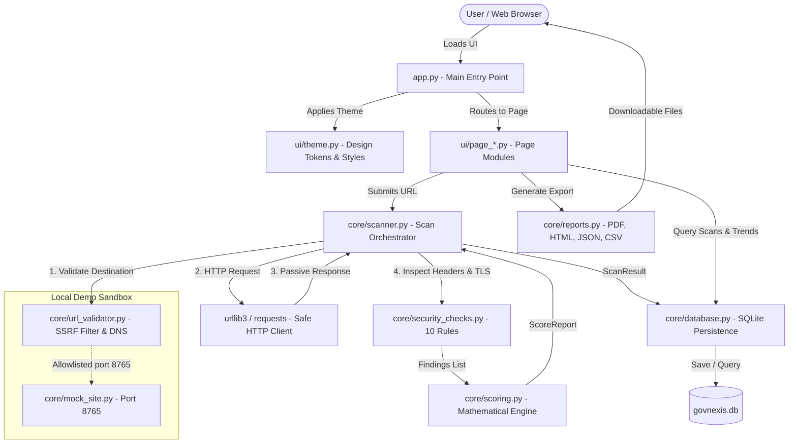

# GOVNEXIS — Complete Codebase Walkthrough & Architecture Guide

> **Subtitle:** Government Web Security Configuration Auditing Platform  
> **Tagline:** *See the Risk. Fix the Gap. Build Trust.*

This document provides a beginner-friendly, plain-English walkthrough of the entire GOVNEXIS codebase. It is designed for students, contributors, and hackathon judges to understand how every part of the application works, how data flows from user input to executive report, and how each component connects together.

---

## 1. High-Level Architecture

GOVNEXIS is built with a modular, layered architecture that strictly separates user interface logic, network scanning, security evaluation, persistence, and reporting.



---

## 2. Application Startup Flow

When you run `streamlit run app.py`:

1. **Streamlit Configuration (`app.py`, Lines 10–15)**:
   - `st.set_page_config()` runs first. It sets the browser tab title (`GOVNEXIS — Government Web Security Auditing`), the shield icon, wide layout mode, and expanded sidebar.
2. **Database Initialization (`core/database.py:init_db()`)**:
   - Creates the local SQLite database file (`govnexis.db`) if it doesn't exist.
   - Creates three relational tables: `scans`, `findings`, and `remediation_tasks` with appropriate indexes.
3. **Demo History Seeding (`core/database.py:seed_demo_history()`)**:
   - If the database is completely empty on first launch, it seeds realistic sample scan records (e.g. municipal portals) so the dashboard is immediately demonstrable.
4. **Local Demo Sandbox (`core/mock_site.py:start_mock_server()`)**:
   - Spawns a lightweight daemon thread running Python's built-in `http.server` on `127.0.0.1:8765`.
   - Starts in baseline misconfigured mode (missing headers, weak cookies) ready for one-click hackathon demonstrations without needing an internet connection.
5. **Theme Injection (`ui/theme.py:apply_theme()`)**:
   - Reads the user's persisted theme preference (from `.theme_preference` or session state).
   - Dynamically compiles CSS variables and styles based on the active palette (`DARK_TOKENS` or `LIGHT_TOKENS`).
   - Injects the compiled stylesheet into the browser via `st.html()`.
6. **Navigation & Page Rendering (`app.py:main()`)**:
   - Renders the sidebar with brand identity, 9 navigation items, the theme toggle button, and federal compliance badges.
   - Matches the selected page name and executes the corresponding `render_*_page()` function.

---

## 3. How a URL Enters the Scanner

When a user submits a URL on the **New Scan** page:

1. **Authorization Check (`ui/page_scanner.py`)**:
   - The user must check the authorization confirmation checkbox (`I confirm authorization to audit this public website`). If unchecked, the scan refuses to execute.
2. **Orchestrator Execution (`core/scanner.py:execute_scan()`)**:
   - The scanner is invoked with `target_url`, `user_confirmed_authorization=True`, and `allow_local_demo` (True only for the sandbox).
3. **Pre-flight Validation (`core/url_validator.py:validate_url()`)**:
   - Before opening any network socket, the URL string is parsed and validated.

---

## 4. How URL Validation & SSRF Defense Work

GOVNEXIS incorporates a strict defense filter in `core/url_validator.py` to prevent Server-Side Request Forgery (SSRF) and abuse:

1. **Scheme Validation**:
   - Only `http://` and `https://` schemes are permitted. Schemes like `file://`, `ftp://`, `gopher://`, or `javascript:` are rejected immediately.
2. **Hostname Validation**:
   - Hostnames must contain valid DNS characters and at least one dot (e.g., `agency.gov`), unless the target is specifically the local demo sandbox on `127.0.0.1:8765`.
3. **DNS Resolution & IP Verification (`is_ip_allowed()`)**:
   - The scanner resolves the hostname to all assigned IPv4/IPv6 addresses via `socket.getaddrinfo()`.
   - Each IP is converted into an `ipaddress.ip_address` object and evaluated against forbidden ranges:
     - **Private subnets (RFC 1918)**: `10.0.0.0/8`, `172.16.0.0/12`, `192.168.0.0/16`
     - **Loopback addresses**: `127.0.0.0/8`, `::1` (blocked unless `allow_local_demo=True` AND port is 8765)
     - **Link-local & Cloud Metadata**: `169.254.169.254`, `169.254.0.0/16` (protects AWS/GCP/Azure instance metadata)
     - **Multicast & Reserved**: `224.0.0.0/4`, `240.0.0.0/4`
4. **Redirect Validation (`validate_redirect()`)**:
   - If the server returns a 301/302 redirect to a new URL, the redirect destination is passed through the exact same validator before following.
   - Redirect chains are capped at 5 hops to prevent infinite redirect loops.

---

## 5. How an HTTP Response Is Inspected

Once destination safety is verified, `core/scanner.py` dispatches a passive HTTP GET request:

1. **Request Hygiene**:
   - Uses a standard browser-like User-Agent (`GOVNEXIS-Auditor/1.0 (+https://govnexis.internal; Defense-Only Security Configuration Audit)`).
   - Sets a 5.0-second connection timeout and 5.0-second read timeout.
   - Enforces a 5 MB maximum response size limit to prevent memory exhaustion attacks.
2. **Data Extraction**:
   - **Response Headers**: Normalized to lowercase dictionary keys (e.g., `strict-transport-security`, `content-security-policy`, `x-frame-options`).
   - **Cookies**: Extracted from `Set-Cookie` headers and parsed for security flags (`Secure`, `HttpOnly`, `SameSite`).
   - **TLS Observation**: For HTTPS targets, the TLS certificate hostname, issuer, expiration, and cipher suite are inspected.
   - **Body Hash**: A SHA-256 fingerprint of the response body is recorded for audit integrity.

---

## 6. How Security Rules Produce Findings

In `core/security_checks.py`, the extracted response data is evaluated against 10 deterministic security checks:

| Check Function | Rule Evaluated | Standard / Rationale |
|---|---|---|
| `check_https_enforcement()` | Does URL use HTTPS? Does HTTP redirect to HTTPS? | NIST SP 800-52r2 |
| `check_hsts()` | Is `Strict-Transport-Security` present with `max-age >= 31536000`? | CISA BOD 18-01 |
| `check_content_security_policy()` | Is `Content-Security-Policy` defined? Are `unsafe-inline`/`unsafe-eval` avoided? | OWASP Top 10 A03 (XSS) |
| `check_clickjacking_defense()` | Is `X-Frame-Options` (`DENY`/`SAMEORIGIN`) or CSP `frame-ancestors` present? | CWE-1021 |
| `check_x_content_type_options()` | Is `X-Content-Type-Options: nosniff` enabled? | MIME-Confusion Defense |
| `check_cookie_security()` | Do all session cookies set `Secure`, `HttpOnly`, and `SameSite`? | Session Hijacking Defense |
| `check_referrer_policy()` | Is `Referrer-Policy` set to a privacy-preserving value? | Data Leakage Prevention |
| `check_permissions_policy()` | Is `Permissions-Policy` present restricting camera/mic/geo? | Hardware API Restriction |
| `check_server_disclosure()` | Do `Server` or `X-Powered-By` leak specific software versions? | Reconnaissance Mitigation |
| `check_tls_configuration()` | Is the TLS certificate valid, trusted, and unexpired? | Transport Layer Defense |

Each check returns a structured `FindingRecord` object containing:
- `status`: `"PASS"`, `"FAIL"`, or `"WARNING"`
- `severity`: `"Critical"`, `"High"`, `"Medium"`, `"Low"`, or `"Info"`
- `evidence`: The exact header value or configuration observed
- `why_it_matters`: Plain-English cybersecurity explanation
- `potential_impact`: What an attacker could exploit
- `recommended_action`: Exact remediation guidance

---

## 7. Official CVSS v3.0 Vulnerability Severity Matrix

GOVNEXIS exclusively utilizes the **Common Vulnerability Scoring System (CVSS) v3.0 methodology** (published by FIRST) as its sole risk matrix and scoring system across the entire application:

### 7.1 Exclusive CVSS v3.0 Matrix Methodology (0.0–10.0 Scale)
In `core/cvss.py`, GOVNEXIS implements the **official FIRST CVSS v3.0 specification** (not v3.1, v4.0, or custom heuristics):

#### Base Metrics & Weighting
- **Exploitability Metrics**:
  - **Attack Vector (AV)**: Network (`N`: 0.85), Adjacent (`A`: 0.62), Local (`L`: 0.55), Physical (`P`: 0.20)
  - **Attack Complexity (AC)**: Low (`L`: 0.77), High (`H`: 0.44)
  - **Privileges Required (PR)** (*Scope-dependent*):
    - *Scope Unchanged*: None (`N`: 0.85), Low (`L`: 0.62), High (`H`: 0.27)
    - *Scope Changed*: None (`N`: 0.85), Low (`L`: 0.68), High (`H`: 0.50)
  - **User Interaction (UI)**: None (`N`: 0.85), Required (`R`: 0.62)
- **Impact Metrics**:
  - **Scope (S)**: Unchanged (`U`), Changed (`C`)
  - **Confidentiality (C)**: None (`N`: 0.0), Low (`L`: 0.22), High (`H`: 0.56)
  - **Integrity (I)**: None (`N`: 0.0), Low (`L`: 0.22), High (`H`: 0.56)
  - **Availability (A)**: None (`N`: 0.0), Low (`L`: 0.22), High (`H`: 0.56)

#### Official Equations
1. **Impact Sub-Score (ISS)**:
   $$ISS = 1 - [ (1 - C) \times (1 - I) \times (1 - A) ]$$
2. **Impact**:
   - If Scope is Unchanged:
     $$Impact = 6.42 \times ISS$$
   - If Scope is Changed:
     $$Impact = 7.52 \times (ISS - 0.029) - 3.25 \times (ISS - 0.02)^{15}$$
3. **Exploitability**:
   $$Exploitability = 8.22 \times AV \times AC \times PR \times UI$$
4. **Base Score**:
   - If $Impact \le 0$: $BaseScore = 0.0$
   - If Scope Unchanged:
     $$BaseScore = Roundup(\min(Impact + Exploitability, 10))$$
   - If Scope Changed:
     $$BaseScore = Roundup(\min(1.08 \times (Impact + Exploitability), 10))$$

#### Official CVSS v3.0 Roundup Specification
CVSS v3.0 defines `Roundup(val)` as the smallest number, specified to one decimal place, that is greater than or equal to the input parameter (e.g. 4.02 rounds up to 4.1). In `core/cvss.py`, this is implemented as:
```python
math.ceil(round(val, 9) * 10.0) / 10.0
```

#### Official Severity Scale
- **None**: 0.0
- **Low**: 0.1 – 3.9
- **Medium**: 4.0 – 6.9
- **High**: 7.0 – 8.9
- **Critical**: 9.0 – 10.0

### 7.3 Grounded Findings Mapping & "Not Scored" Policy
A fundamental rule in GOVNEXIS is that **missing HTTP security headers are NOT proof of an exploitable vulnerability**. Without evidence of a vulnerable injection sink, upload handler, or private query parameter, assigning an arbitrary CVSS score is indefensible.

| Security Check | Audit Status | CVSS v3.0 Vector String | CVSS Score | Technical Rationale |
|---|---|---|---|---|
| **HTTPS Enforcement** | FAIL | `CVSS:3.0/AV:N/AC:H/PR:N/UI:N/S:U/C:H/I:H/A:N` | **7.4 High** | Cleartext traffic allows Man-in-the-Middle eavesdropping & packet tampering. |
| **HSTS Enforcement** | FAIL | `CVSS:3.0/AV:N/AC:H/PR:N/UI:R/S:U/C:H/I:H/A:N` | **6.8 Medium** | SSL-stripping attack downgrades first connection to cleartext HTTP. |
| **Clickjacking (XFO)** | FAIL | `CVSS:3.0/AV:N/AC:L/PR:N/UI:R/S:U/C:N/I:L/A:N` | **4.3 Medium** | Framing page in transparent iframe tricks user into executing unwanted state changes. |
| **Cookie Security** | FAIL | `CVSS:3.0/AV:N/AC:H/PR:N/UI:R/S:U/C:H/I:N/A:N` | **5.3 Medium** | Missing `Secure` flag leaks session cookie over unencrypted channels. |
| **Server Disclosure** | FAIL/WARN | `CVSS:3.0/AV:N/AC:L/PR:N/UI:N/S:U/C:L/I:N/A:N` | **5.3 Medium** | Version disclosure assists attacker reconnaissance and CVE targeting. |
| **TLS Certificate** | FAIL | `CVSS:3.0/AV:N/AC:L/PR:N/UI:N/S:U/C:N/I:N/A:H` | **7.5 High** | Expired certificate prevents access, causing total denial of secure service. |
| **Content Security Policy** | FAIL | *N/A — Not Scored* | **Not Scored** | Defense-in-depth: Requires confirmed XSS or injection flaw to establish exploit path. |
| **Permissions-Policy** | FAIL | *N/A — Not Scored* | **Not Scored** | Defense-in-depth: Requires exploit path targeting client hardware APIs. |
| **Referrer-Policy** | FAIL | *N/A — Not Scored* | **Not Scored** | Defense-in-depth: Requires sensitive session tokens in URLs. |
| **MIME-Sniffing (XCTO)** | FAIL | *N/A — Not Scored* | **Not Scored** | Defense-in-depth: Requires user upload or reflection endpoint. |
| **Any Passing Rule** | PASS | `CVSS:3.0/AV:N/AC:L/PR:N/UI:N/S:U/C:N/I:N/A:N` | **0.0 None** | Requirement verified; no vulnerability present. |

> **Limitations Notice**: CVSS v3.0 assesses intrinsic vulnerability severity under standardized worst-case conditions. A CVSS score is not a probability index, an SLA, or a guarantee that a website will or will not be attacked.

---

## 8. How Results Are Stored in SQLite

In `core/database.py`, scan results are saved in a local SQLite file (`govnexis.db`):

- **`scans` table**: Stores target URL, final destination, hostname, timestamp, final score, letter grade, HTTP status code, duration in milliseconds, check counts (passed/failed/warning), and the raw JSON report.
- **`findings` table**: Linked by `scan_id`. Stores each individual finding, severity, check ID, status, evidence, explanations, and `verification_status` (`Open`, `In Progress`, `Fixed`, `Verified`).
- **`remediation_tasks` table**: Automatically populated when a scan discovers `FAIL` or `WARNING` findings. Links to the host, title, status, and engineer notes.

---

## 9. How the Dashboard Reads Data

In `ui/page_overview.py`:

1. Queries aggregated metrics using `get_scan_trends()`.
2. Computes summary numbers from real stored records: Total Scans, Average Score, High/Critical Findings, and Verified Findings.
3. If no scans exist, renders a clean empty state inviting the user to run a scan.
4. Visualizes trends using Plotly charts styled to match the active theme:
   - **Severity Donut Chart**: Proportions of Critical, High, Medium, Low findings.
   - **Category Horizontal Bar Chart**: Top vulnerability categories (Transport, Injection, Headers).
   - **Score History Line Chart**: Target score progression over chronological audits.
   - **Recent Scans Table**: Quick view of latest audited hosts.

---

## 10. How Reports Are Generated

In `core/reports.py`, executive reports are dynamically built from the scan dictionary:

- **PDF Report (`generate_pdf_report`)**: Uses ReportLab to generate a publication-ready vector PDF document with executive scorecard, letter grade badge, check status table, and remediation annex.
- **HTML Report (`generate_html_report`)**: Self-contained, single-file HTML report with embedded responsive CSS, ready for emailing or printing.
- **JSON Report (`generate_json_report`)**: Machine-readable JSON adhering to standard security schema for integration with CI/CD pipelines or SIEMs.
- **CSV Report (`generate_csv_report`)**: Flat spreadsheet format ready for importing into Jira, GitHub Issues, or Excel.

---

## 11. How the Theme Switcher Works

The theme system is centralized in `ui/theme.py`:

1. **Design Tokens**: Defined in two dictionaries:
   - `DARK_TOKENS`: Deep graphite background (`#171B22`), elevated surface (`#202630`), muted emerald accent (`#36A779`), restrained teal (`#4D9DAD`).
   - `LIGHT_TOKENS`: Clean neutral grey canvas (`#F4F6F8`), white cards (`#FFFFFF`), deep emerald accent (`#187A56`), deep teal (`#267787`).
2. **Persistence**:
   - When the user clicks the theme toggle or selects a theme in Settings, `set_theme(new_theme)` updates `st.session_state["govnexis_theme"]` and writes the preference to the file `.theme_preference` in the project root.
   - On the next rerun or browser refresh, `get_current_theme()` loads the saved preference.
3. **Dynamic CSS Generation (`_generate_css()`)**:
   - Takes the active tokens and compiles a comprehensive CSS block with CSS variables (`--gn-bg`, `--gn-surface`, `--gn-accent`, etc.).
   - Applies styles to all Streamlit native components (sidebar, buttons, inputs, tables, tabs, expanders) and custom `.gn-*` utility classes.
4. **No Emojis**:
   - All emoji symbols have been completely replaced with clean typography, clear text badges (`PASS`, `FAIL`), and consistent SVG line icons.

---

## 12. File Directory Map

| Path | Purpose | Key Functions / Classes |
|---|---|---|
| `app.py` | Main entry point & sidebar router | `main()` |
| `core/config.py` | Central configuration, constants, check weights | `CHECK_WEIGHTS`, `LOCAL_DEMO_URL`, `DATABASE_PATH` |
| `core/database.py` | SQLite database schema, CRUD, trends, remediation | `init_db()`, `save_scan()`, `get_all_scans()`, `get_scan_trends()` |
| `core/mock_site.py` | Local sandbox HTTP server on port 8765 | `start_mock_server()`, `MockServerState`, `DEMO_STATE` |
| `core/reports.py` | Multi-format report generation | `generate_pdf_report()`, `generate_html_report()`, `generate_json_report()` |
| `core/scanner.py` | Safe passive HTTP scanner orchestrator | `execute_scan()`, `ScanResult` |
| `core/scoring.py` | Deterministic mathematical scoring engine | `calculate_score()`, `ScoreReport` |
| `core/security_checks.py` | 10 passive security rule definitions | `run_all_checks()`, `FindingRecord` |
| `core/url_validator.py` | SSRF defense, DNS resolution, destination allowlist | `validate_url()`, `is_ip_allowed()`, `validate_redirect()` |
| `ui/theme.py` | Dark/light design tokens, CSS compiler, UI helpers | `apply_theme()`, `get_tokens()`, `get_current_theme()`, `set_theme()` |
| `ui/page_overview.py` | Executive dashboard & trends | `render_overview_page()` |
| `ui/page_scanner.py` | New scan form, progress animation, results card | `render_scanner_page()` |
| `ui/page_findings.py` | Findings center with multi-dimensional filtering | `render_findings_page()` |
| `ui/page_remediation.py` | Playbooks for Nginx/Apache/Caddy/Node/Python | `render_remediation_page()` |
| `ui/page_verification.py` | Before-and-after scan comparison engine | `render_verification_page()` |
| `ui/page_history.py` | Chronological scan logs and record deletion | `render_history_page()` |
| `ui/page_reports.py` | In-browser preview and file downloads | `render_reports_page()` |
| `ui/page_demo_lab.py` | Hackathon interactive sandbox controls | `render_demo_lab_page()` |
| `ui/page_settings.py` | Architecture notes, theme switcher, error help | `render_settings_page()` |
| `tests/` | 44 automated pytest test cases | `test_scanner.py`, `test_security_checks.py`, etc. |

---

## 13. Hackathon Team Code-Review Checklist

Before presenting to hackathon judges, every team member should be prepared to answer these questions:

### Architecture & Safety
- [ ] **Q1: Can an attacker use GOVNEXIS to scan internal government networks or cloud metadata?**  
  *Answer:* No. The multi-layer SSRF filter in `core/url_validator.py` resolves DNS hostnames and rejects loopback (127.0.0.0/8), RFC 1918 private subnets (10.x, 172.16.x, 192.168.x), and cloud metadata IPs (169.254.169.254) before any HTTP connection is attempted.
- [ ] **Q2: Does scanning risk crashing or disrupting a target website?**  
  *Answer:* No. GOVNEXIS is 100% passive and non-destructive. It performs a single standard HTTP GET request with standard headers, identical to an ordinary browser loading the webpage. No exploit payloads, fuzzing, or brute-force tests are ever performed.
- [ ] **Q3: What happens if a target returns a redirect?**  
  *Answer:* The redirect URL is validated through the exact same SSRF filter (`validate_redirect()`). Redirects to private IPs are blocked, and redirects are capped at 5 hops to prevent circular redirect loops.

### Scoring & Findings
- [ ] **Q4: How does scoring work? Is it an arbitrary guess?**  
  *Answer:* Scoring is 100% deterministic and mathematical. It starts at 100 points, applies weighted deductions based on standard security mandates (CISA BOD 18-01, NIST SP 800-52r2), and awards 50% partial credit for warnings. The math is fully inspectable in `core/scoring.py`.
- [ ] **Q5: What are the 10 security checks?**  
  *Answer:* (1) HTTPS Enforcement, (2) HSTS, (3) Content-Security-Policy, (4) Clickjacking Defense (X-Frame-Options/frame-ancestors), (5) MIME-Sniffing (X-Content-Type-Options), (6) Cookie Security (Secure, HttpOnly, SameSite), (7) Referrer-Policy, (8) Permissions-Policy, (9) Server Info Disclosure, and (10) TLS Certificate validity.

### Demo & Presentation
- [ ] **Q6: Why use the Local Demo Lab instead of a live internet site during presentation?**  
  *Answer:* Hotel Wi-Fi can be unreliable or blocked. The Local Demo Lab runs on `127.0.0.1:8765` completely offline. It demonstrates both baseline misconfigurations (Score ~35/F) and hardened defense posture (Score ~95/A+), showing empirical verification with a +60 pt delta.
- [ ] **Q7: How is a finding verified as fixed?**  
  *Answer:* In GOVNEXIS, a finding is never marked fixed just by clicking a button. The **Verification Engine** compares a baseline scan against a subsequent scan to empirically prove the gap is resolved.

### UI & Theme System
- [ ] **Q8: How does dark and light theme switching work?**  
  *Answer:* `ui/theme.py` defines tokens in `DARK_TOKENS` and `LIGHT_TOKENS`. The selected theme is stored in session state and persisted to `.theme_preference`. Streamlit dynamically receives custom CSS with CSS variables on every rerun.
- [ ] **Q9: Why are there no emojis in the UI?**  
  *Answer:* Enterprise cybersecurity tools require a calm, restrained, professional visual identity. Emojis have been replaced with clear status text, badges, and clean typography.
